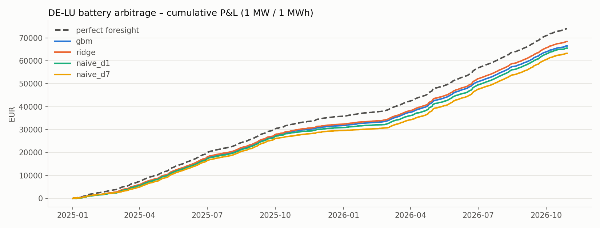

# Day-Ahead Power Price Forecasting & Battery Arbitrage

Hourly forecasts of the **German day-ahead electricity price (DE-LU bidding zone)** from weather
forecasts, lagged prices and calendar effects, evaluated walk-forward over 22 months. The forecasts
then drive a **battery arbitrage strategy** backtested on realised auction prices.

The focus is methodological: every feature is restricted to what a trader actually knows at
**gate closure (D-1, 12:00 CET)**, and models are only ever trained on the past.

## Results – DE-LU, out-of-sample 1 Jan 2025 → 29 Oct 2026 (667 delivery days)

**Forecast accuracy** (EUR/MWh, hourly). rMAE is the MAE relative to the weekly naive benchmark.
DM p-value: Diebold–Mariano test that the best model is more accurate (daily-averaged losses).

| Model | MAE | RMSE | rMAE | sMAPE | DM p-value vs best |
|---|---:|---:|---:|---:|---:|
| Gradient boosting | **20.2** | **30.7** | **0.55** | **35.6 %** | – |
| Ridge (LEAR-style) | 23.1 | 33.0 | 0.63 | 39.6 % | < 0.001 |
| Naive D-1 | 29.0 | 45.4 | 0.79 | 48.1 % | < 0.001 |
| Naive D-7 | 36.5 | 55.4 | 1.00 | 54.9 % | < 0.001 |

**Battery arbitrage** (1 MW / 1 MWh, one cycle per day, 85 % round-trip efficiency).
Capture rate is the P&L as a share of the perfect-foresight P&L (€74.0k, about €40.5k per MW per year).

| Forecast used | P&L (EUR) | Capture rate | Profitable trades | Worst day (EUR) |
|---|---:|---:|---:|---:|
| Ridge | **68,400** | **92.4 %** | 99.1 % | −22 |
| Gradient boosting | 66,515 | 89.9 % | 98.9 % | −17 |
| Naive D-1 | 65,537 | 88.6 % | 96.8 % | −49 |
| Naive D-7 | 63,251 | 85.5 % | 97.4 % | −51 |




### Takeaways

- Gradient boosting cuts the error of the weekly naive benchmark by **45 %**. An ablation without
  the weather features gives an MAE of 27.0 instead of 20.2, so **weather forecasts alone reduce the
  error by a quarter**. The rest of the gain comes from recent price lags and calendar effects.
- **The most accurate model is not the most profitable one.** The battery only cares about which
  hours are the cheapest and the most expensive of the day, not about price levels. Ridge earns
  2.5 points more capture than gradient boosting, although gradient boosting is more accurate and
  even ranks the hours slightly better on average (intraday Spearman 0.883 vs 0.875). Accuracy
  metrics and trading value answer different questions.
- Even naive forecasts capture 85 % of the perfect-foresight value, because the German daily shape
  (solar trough at midday, evening peak) is very regular. Forecasting adds the last 5–7 points of
  capture.

## Avoiding look-ahead bias

| Input | What is used | Why it is available at D-1 12:00 |
|---|---|---|
| Prices | Same hour on D-1, D-2, D-7; D-1 mean/min/max | D-1 prices are published after the D-2 auction |
| Weather | Archived **forecasts**, not observations | D-1 run if issued before gate closure, otherwise the D-2 run |
| Calendar | Hour, weekday, month, public holidays | Known in advance |
| Models | Expanding window, refit monthly | Trained only on delivery days before the test month |

These rules are checked by unit tests (`tests/test_no_lookahead.py`): perturbing all prices of a
delivery day must leave that day's features unchanged, weather must come from a run issued
before gate closure, and walk-forward training data must end before the first test day.

## Data

- **Day-ahead prices:** [Energy-Charts API](https://api.energy-charts.info) (Fraunhofer ISE; data
  Bundesnetzagentur | SMARD.de, CC BY 4.0). Since 1 Oct 2025 the auction clears 15-minute products,
  which are averaged to hourly values.
- **Weather forecasts:** [Open-Meteo previous-runs API](https://open-meteo.com) – temperature, 100 m
  wind speed, solar radiation and cloud cover, as forecast one and two days ahead, averaged over six
  German locations (demand centres and a North Sea wind cluster). Complete from March 2024.

## Backtest assumptions

Price-taker in the day-ahead auction (no market impact), one charge hour followed by one discharge
hour per day, battery empty at the start of each day, efficiency applied on the sell leg, and no
degradation or grid fees.

## Code

```
src/powerfc/
  data.py        downloads, caching, gate-closure-consistent weather selection
  features.py    lagged prices, weather, calendar
  models.py      naive benchmarks, ridge, gradient boosting, walk-forward loop
  evaluate.py    MAE / RMSE / rMAE / sMAPE, Diebold–Mariano test
  backtest.py    battery arbitrage on forecasts, settled on realised prices
  plots.py       report figures
tests/           look-ahead and backtest unit tests
```

```bash
pip install -e ".[dev]"
python -m powerfc --zone DE-LU --test-start 2025-01-01   # also supports --zone FR
pytest
```
